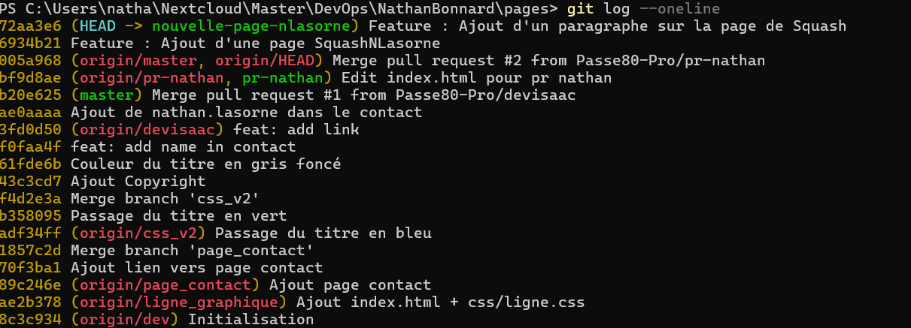
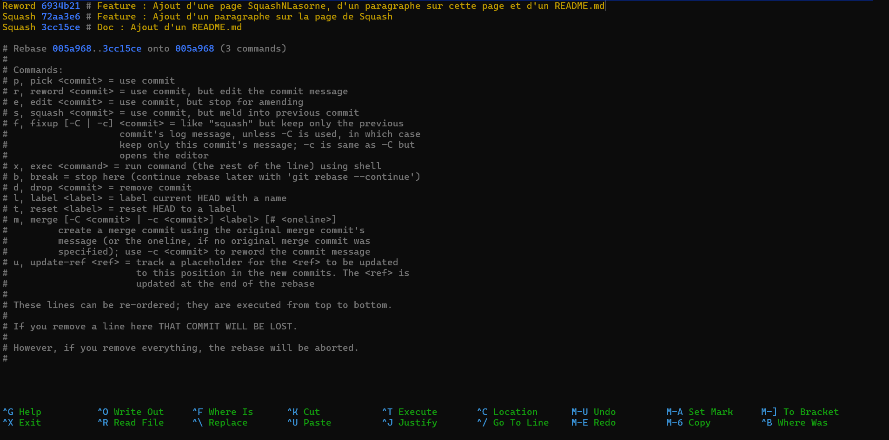
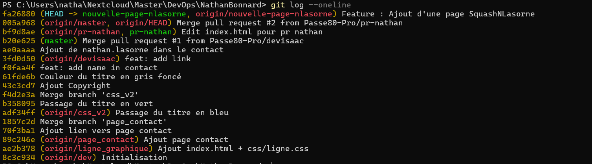

# Rédigé par Nathan Bonnard et Ishak Haithem Hamadat

Question 1) La commande `git push --force-with-lease` effectue la même action que la commande `git push --force`, à la seule différente que l'option `--force-with-lease` vérifie que la branche distante, qu'on s'apprête à écraser, n'a pas été modifiée par une autre personne, ce qui permet d'éviter d'écraser le travail d'un collègue.

Question 2) La commande `git merge` modifie la branche en créant un commit de merge (sauf si un fast-forward est possible). `git rebase` permet de récupérer les modifications d'une branche source sans la modifier, tout en gardant un historique de commits plus propre.

Question 3) Imposer un squash des commits avant la fusion d'une Pull Request permet dans un premier temps d'obtenir une PR plus lisible pour le reviewer, puisque toutes les modifications seront visibles depuis un seul commit, et dans un second temps de ne garder qu'un commit par feature, ce qui rend l'historique de commits final lui aussi plus lisible, avec un commit par feature.

----

Gitlog Nathan Lasorne :

Git rebase Nathan Lasorne :

Git log après git rebase Nathan Lasorne

image de ishak

image de ishak

